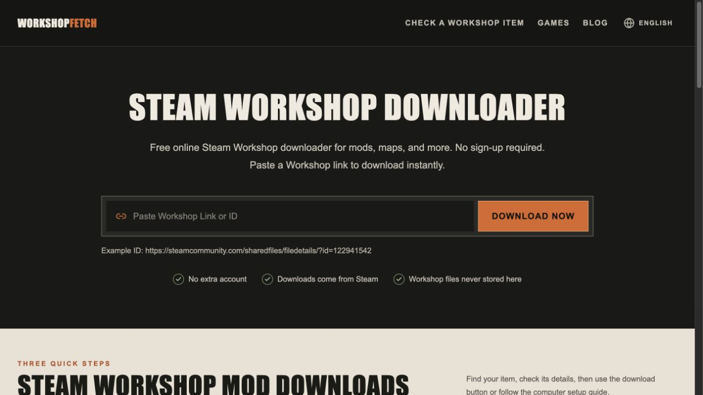

# WorkshopFetch

**Free online Steam Workshop downloader for mods, maps, and more.**

No sign-up required. Paste a Workshop link or item ID to find available downloads.

**[Open WorkshopFetch →](https://workshopfetch.com/)**

English · [简体中文](README.zh-CN.md)

WorkshopFetch works in your browser and checks one public Workshop item at a time. For collections, open the individual mod or map you want to download.

## Steam Workshop Mod Downloads

1. Copy a mod or map's URL from Steam Workshop. You can also use its numeric ID (Published File ID).
2. [Open WorkshopFetch](https://workshopfetch.com/), paste the link or ID, and click **Download Now**. On the result page, check the title and game to make sure it's the right item.
3. Use **Download file** if the button appears. If it doesn't, follow [How to Use](https://workshopfetch.com/how-to-use) for another method you can try on your computer.

Need help? [Find an item's ID](https://workshopfetch.com/blog/find-steam-workshop-id) · [Troubleshoot downloads](https://workshopfetch.com/steam-workshop-download-not-working)

## Steam Workshop Download FAQ

### Why can't I download some items?

Steam doesn't make every item available to download in a browser. Other download methods may require you to own the game or sign in with a Steam account that has access. WorkshopFetch can't bypass those requirements or make private content available, so following the guide doesn't guarantee a successful download.

### Where do the files come from?

When you click the download button, the file comes from Steam's servers. WorkshopFetch only uses download links returned by Steam. It doesn't store, forward, or redistribute Workshop files, and it never asks for your Steam password.

### Is the website open source?

No. This is the official repository for the product overview, screenshots, and guides. The website's source code is private.

## Feedback

Something not working? [Open an issue](https://github.com/ai-ashao/workshopfetch/issues) with the public Workshop URL and what went wrong. Suggestions are welcome too. Please leave out passwords and other private information.

---

WorkshopFetch is an independent tool and is not affiliated with Valve Corporation or Steam. Workshop content belongs to its respective creators and rights holders.
