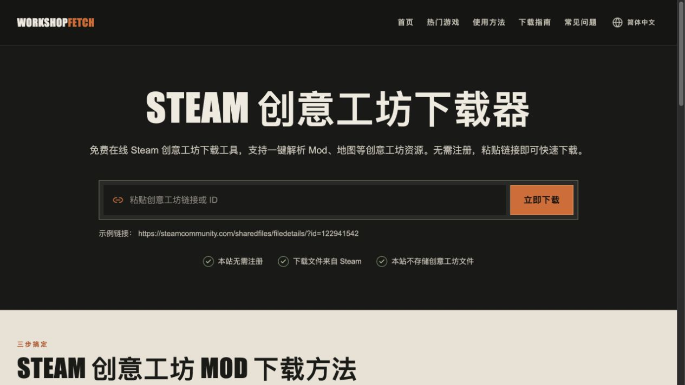

# WorkshopFetch

**免费在线 Steam 创意工坊下载工具。**

无需注册。粘贴 Mod、地图等创意工坊内容的链接或 ID，查看可用的下载方式。

**[打开 WorkshopFetch →](https://workshopfetch.com/zh-cn)**

[English](README.md) · 简体中文

WorkshopFetch 可以直接在浏览器里使用，每次查询一个 Mod、地图或其他创意工坊作品。如果你打开的是合集，请先进入想下载的单个作品页面。

## 创意工坊 Mod 下载方法

1. 在 Steam 创意工坊找到想下载的 Mod 或地图，复制页面链接。也可以直接使用链接里的数字 ID（Published File ID）。
2. [打开 WorkshopFetch](https://workshopfetch.com/zh-cn)，粘贴链接或 ID，点击「立即下载」。在结果页核对标题和所属游戏，确认没找错。
3. 结果页有「下载文件」按钮时，点击下载。没有按钮时，可以按[使用教程](https://workshopfetch.com/zh-cn/how-to-use)在自己的电脑上尝试另一种下载方法。

相关教程：[在哪里找作品 ID](https://workshopfetch.com/zh-cn/blog/find-steam-workshop-id) · [下载卡住了怎么办](https://workshopfetch.com/zh-cn/blog/steam-workshop-download-stuck)

## 创意工坊下载常见问题

### 为什么有些 Mod 还是下载不了？

Steam 没有为每个作品返回可用的下载地址。其他下载方法也可能要求你拥有游戏本体，或登录有访问权限的 Steam 账号。WorkshopFetch 无法绕过这些要求，也不能下载私有作品，因此按教程操作也不一定能下载成功。

### 下载的文件来自哪里？

点击下载按钮后，文件会从 Steam 的服务器下载到你的设备。本站只使用 Steam 返回的下载地址，不保存、中转或重新分发创意工坊文件，也不会索取你的 Steam 密码。

### 这个仓库包含网站源码吗？

不包含。这是 WorkshopFetch 的官方介绍仓库，公开产品介绍、截图和使用文档，网站源码没有开源。

## 问题反馈

用的时候遇到问题，可以[提个 Issue](https://github.com/ai-ashao/workshopfetch/issues)，贴上公开的创意工坊链接，说说卡在哪一步。有建议也欢迎告诉我们。请不要附上密码或其他私人信息。

---

WorkshopFetch 是独立工具，与 Valve Corporation 或 Steam 无关联。创意工坊内容归相应创作者及权利人所有。
